[Webデモへ戻る](../index.html)

**NN・SVM・クラスタリングなど、学ぶカテゴリごとに44件を整理。** 各カテゴリでは、自分でデータやパラメータを変えられるページを優先して並べている。スクリーンショットは小さなサムネイルで、クリックすると拡大できる。

## 最初に操作する8ページ

| 学びたいこと | 操作するページ | 変えられるもの |
| --- | --- | --- |
| 分類器の比較 | [Decision Boundaries](#algorithm-101) | 点群の形、k、木の深さ、SVMのC、学習率 |
| 決定木 | [A Visual Introduction to Machine Learning](#algorithm-102) | スクロールで分岐・木の成長を追い、点から予測経路を見る |
| NN / MLP | [TensorFlow Playground](#algorithm-049) | 層数、ユニット数、学習率、活性化関数 |
| SVM | [SVMJS](#algorithm-039) | データ点、カーネル、正則化 |
| k-means | [K-Means Clustering](#algorithm-040) | 点群、重心の初期化、反復ステップ |
| PCA | [PCA / EV](#algorithm-057) | 点の位置、投影方向 |
| CNN | [CNN Explainer](#algorithm-063) | 入力画像、表示する層・特徴マップ |
| Transformer | [Transformer Explainer](#algorithm-069) | 入力文、温度、サンプリング設定 |

## 操作性と確認状況

学習カテゴリを軸に区分し、各カテゴリの中では操作型の実験・推論可視化を先に置いた。図解・動画、3D探索、環境準備が必要な分析ツールは各項目の形式欄で区別している。横断ポータルは末尾にまとめた。

掲載先の説明と画面を確認し、サムネイルと操作内容をまとめた。スクリーンショットの取得は全機能の動作保証ではない。Vision Transformer Attention VisualizationとAttentionVizは、前回取得時に読み込み完了を確認できていない。

画像をクリックすると拡大表示できる。操作は見出しや出典のリンク先で行う。各カテゴリ内の掲載順は操作性を重視した編集上の選定。

Narrative Flowの決定木教材はスクロール連動とデータ点へのホバーで学ぶ形式で、任意のパラメータで木を訓練する実験とは操作方法が異なる。

## NN（ニューラルネットワーク）・学習・逆伝播 {#category-nn}

### [TensorFlow Playground](https://playground.tensorflow.org/) {#algorithm-049}

**試せる操作:** データセット、隠れ層数、ユニット数、学習率、活性化関数を変えて学習する。

<figure class="site-screenshot">
  <a href="../assets/ml-algorithm-screenshots/algorithm-049.jpg" target="_blank" rel="noopener">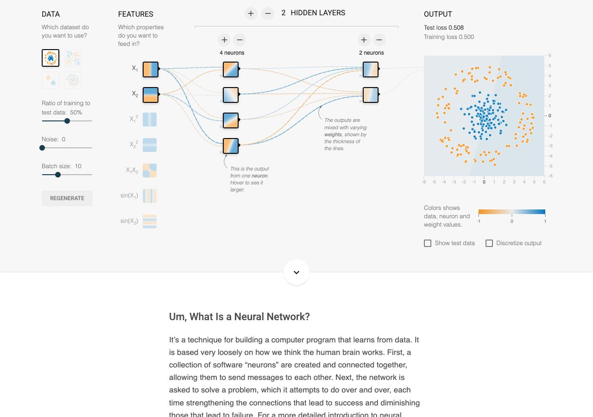</a>
  <figcaption>実ページの画面。 出典: <a href="https://playground.tensorflow.org/#activation=tanh&amp;batchSize=10&amp;dataset=circle&amp;regDataset=reg-plane&amp;learningRate=0.03&amp;regularizationRate=0&amp;noise=0&amp;networkShape=4,2&amp;seed=0.98824&amp;showTestData=false&amp;discretize=false&amp;percTrainData=50&amp;x=true&amp;y=true&amp;xTimesY=false&amp;xSquared=false&amp;ySquared=false&amp;cosX=false&amp;sinX=false&amp;cosY=false&amp;sinY=false&amp;collectStats=false&amp;problem=classification&amp;initZero=false&amp;hideText=false">TensorFlow Playground</a></figcaption>
</figure>

層数、ユニット数、活性化関数、学習率、正則化を変更し、2次元分類・回帰を学習する。各ニューロンの出力と損失を比較。

形式: ブラウザ学習 / 対象: 初級〜中級 / 言語: 英語 / 確認: 本文

### [ConvNetJS](https://cs.stanford.edu/people/karpathy/convnetjs/) {#algorithm-050}

**試せる操作:** 2次元分類デモで点の配置やネットワーク設定を変え、決定境界と中間表現を観察する。

<figure class="site-screenshot">
  <a href="../assets/ml-algorithm-screenshots/algorithm-050.jpg" target="_blank" rel="noopener">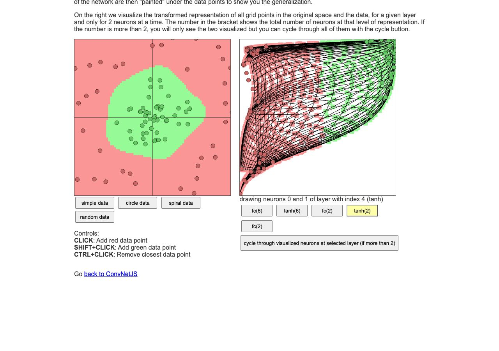</a>
  <figcaption>2次元分類デモの画面。 出典: <a href="https://cs.stanford.edu/people/karpathy/convnetjs/demo/classify2d.html">ConvNetJS</a></figcaption>
</figure>

Andrej Karpathyのブラウザ学習デモ集。2D分類、回帰、MNIST、オートエンコーダ、最適化手法比較への入口。古い実装として利用。

形式: ブラウザ学習 / 対象: 初級〜中級 / 言語: 英語 / 確認: 本文

### [Neural Networks / MLU](https://mlu-explain.github.io/neural-networks/) {#algorithm-051}

<figure class="site-screenshot">
  <a href="../assets/ml-algorithm-screenshots/algorithm-051.jpg" target="_blank" rel="noopener">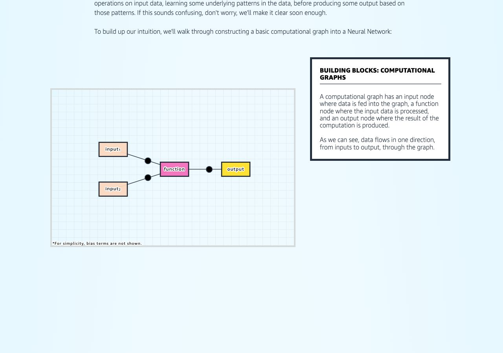</a>
  <figcaption>実ページの画面。 出典: <a href="https://mlu-explain.github.io/neural-networks/">Neural Networks / MLU</a></figcaption>
</figure>

ニューラルネットワークの構造を視覚的に導入する単元。Playgroundの実験に説明を添える際に使う。

形式: 操作・解説 / 対象: 初級〜中級 / 言語: 英語 / 確認: JS・公式目次

### [Why Momentum Really Works](https://distill.pub/2017/momentum/) {#algorithm-054}

<figure class="site-screenshot">
  <a href="../assets/ml-algorithm-screenshots/algorithm-054.jpg" target="_blank" rel="noopener">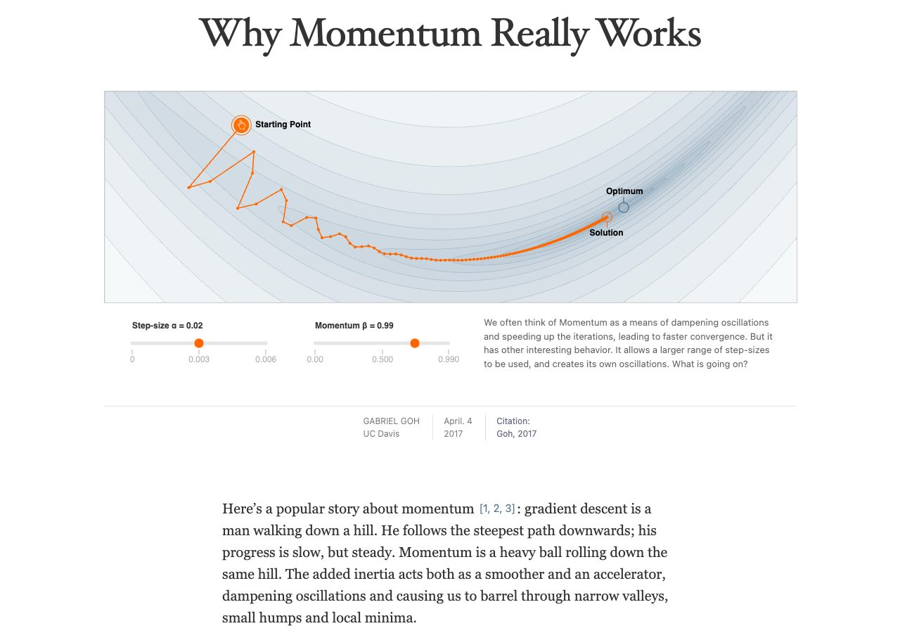</a>
  <figcaption>実ページの画面。 出典: <a href="https://distill.pub/2017/momentum/">Why Momentum Really Works</a></figcaption>
</figure>

勾配降下とモーメンタムの働きを、軌跡・幾何学・数式から探る。学習率と収束の授業を深める。

形式: 操作型論文 / 対象: 中級〜上級 / 言語: 英語 / 確認: 本文

### [Loss Landscape Explorer](https://losslandscape.com/explorer) {#algorithm-055}

<figure class="site-screenshot">
  <a href="../assets/ml-algorithm-screenshots/algorithm-055.jpg" target="_blank" rel="noopener">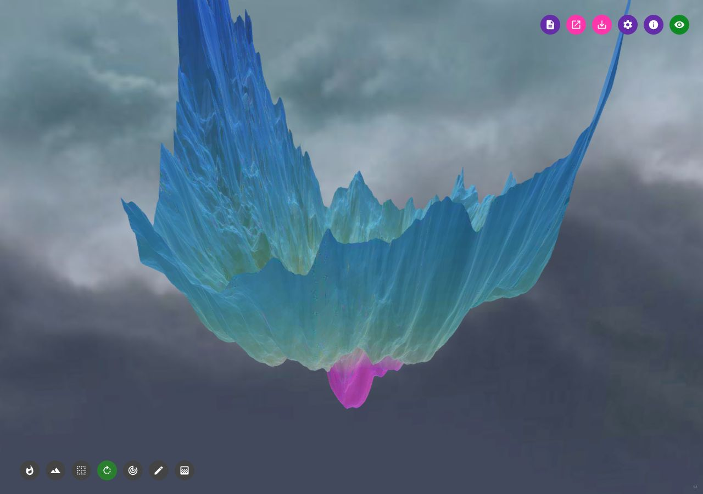</a>
  <figcaption>実ページの画面。 出典: <a href="https://losslandscape.com/explorer">Loss Landscape Explorer</a></figcaption>
</figure>

学習から得た損失地形の低次元可視化を探索する。高次元の重み空間全体を直接表示したものではない。

形式: 3D探索 / 対象: 中級 / 言語: 英語 / 確認: JS・公式説明

### [Calculus on Computational Graphs: Backpropagation](https://colah.github.io/posts/2015-08-Backprop/) {#algorithm-052}

<figure class="site-screenshot">
  <a href="../assets/ml-algorithm-screenshots/algorithm-052.jpg" target="_blank" rel="noopener">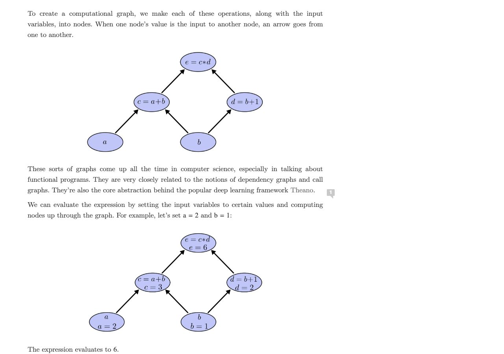</a>
  <figcaption>実ページの画面。 出典: <a href="https://colah.github.io/posts/2015-08-Backprop/">Calculus on Computational Graphs: Backpropagation</a></figcaption>
</figure>

計算グラフ上の連鎖律と勾配の流れを図で説明する。逆伝播のコードを書く前の概念整理に向く。

形式: 図解・数式 / 対象: 中級 / 言語: 英語 / 確認: 本文

### [NNFS Animations](https://nnfs.io/neural_network_animations) {#algorithm-053}

<figure class="site-screenshot">
  <a href="../assets/ml-algorithm-screenshots/algorithm-053.jpg" target="_blank" rel="noopener">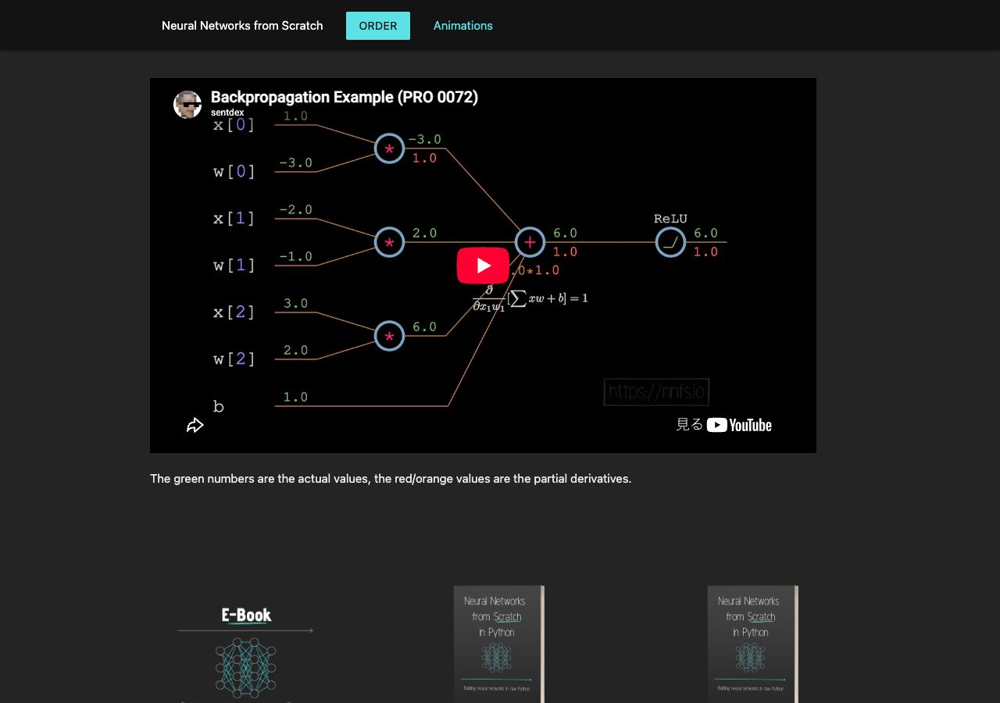</a>
  <figcaption>誤差逆伝播のアニメーション例（再生前）の画面。 出典: <a href="https://nnfs.io/pro/">NNFS Animations</a></figcaption>
</figure>

Neural Networks from Scratchの補助アニメーション。ニューロン、層、計算を映像で補う。書籍は販売物なので無料教材と一括しない。

形式: アニメーション / 対象: 初級〜中級 / 言語: 英語 / 確認: 本文

## SVM（サポートベクターマシン） {#category-svm}

### [SVMJS Demo](https://cs.stanford.edu/people/karpathy/svmjs/demo/) {#algorithm-039}

**試せる操作:** 点の配置、カーネル、正則化Cを変え、決定境界と支持ベクトルを見る。

<figure class="site-screenshot">
  <a href="../assets/ml-algorithm-screenshots/algorithm-039.jpg" target="_blank" rel="noopener">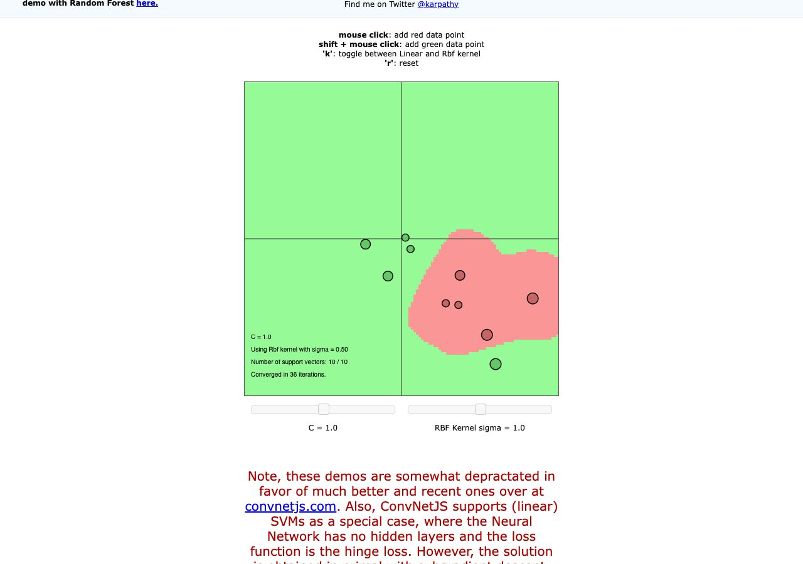</a>
  <figcaption>実ページの画面。 出典: <a href="https://cs.stanford.edu/people/karpathy/svmjs/demo/">SVMJS Demo</a></figcaption>
</figure>

2次元データを使うSVMの実験。カーネルや正則化と、決定境界・支持ベクトルの関係を扱う。

形式: 操作 / 対象: 中級 / 言語: 英語 / 確認: 本文

## クラスタリング {#category-clustering}

### [Visualizing K-Means Clustering](https://www.naftaliharris.com/blog/visualizing-k-means-clustering/) {#algorithm-040}

**試せる操作:** 重心の初期化方法と点群を選び、点の再割当てと重心更新を進める。

<figure class="site-screenshot">
  <a href="../assets/ml-algorithm-screenshots/algorithm-040.jpg" target="_blank" rel="noopener">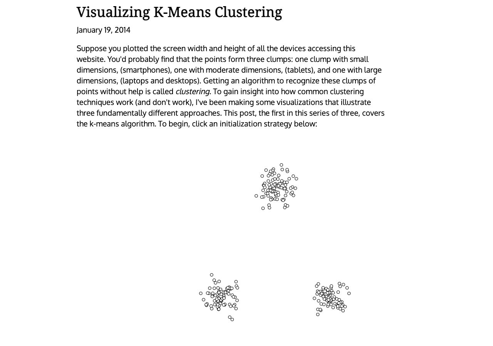</a>
  <figcaption>実ページの画面。 出典: <a href="https://www.naftaliharris.com/blog/visualizing-k-means-clustering/">Visualizing K-Means Clustering</a></figcaption>
</figure>

Naftali Harrisによるk-means可視化。点のクラスタへの割当てと重心更新を反復して観察する。

形式: 操作 / 対象: 初級 / 言語: 英語 / 確認: 本文

## 回帰・確率モデル {#category-regression}

### [Linear Regression / MLU](https://mlu-explain.github.io/linear-regression/) {#algorithm-033}

<figure class="site-screenshot">
  <a href="../assets/ml-algorithm-screenshots/algorithm-033.jpg" target="_blank" rel="noopener">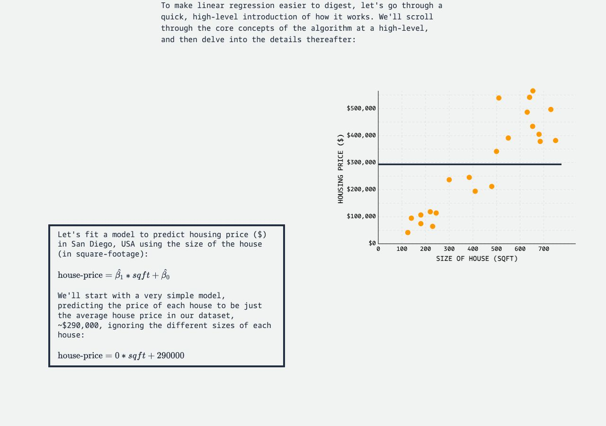</a>
  <figcaption>実ページの画面。 出典: <a href="https://mlu-explain.github.io/linear-regression/">Linear Regression / MLU</a></figcaption>
</figure>

回帰直線と最小二乗法を視覚的に導入する単元。線形回帰の授業への直リンク。

形式: 操作・解説 / 対象: 初級 / 言語: 英語 / 確認: JS・公式目次

### [Logistic Regression / MLU](https://mlu-explain.github.io/logistic-regression/) {#algorithm-034}

<figure class="site-screenshot">
  <a href="../assets/ml-algorithm-screenshots/algorithm-034.jpg" target="_blank" rel="noopener">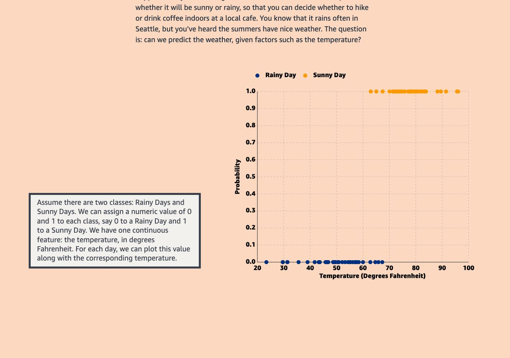</a>
  <figcaption>実ページの画面。 出典: <a href="https://mlu-explain.github.io/logistic-regression/">Logistic Regression / MLU</a></figcaption>
</figure>

シグモイドによる確率予測と二値分類を扱う。回帰と分類の関係を導入する教材。

形式: 操作・解説 / 対象: 初級 / 言語: 英語 / 確認: JS・公式目次

### [Ordinary Least Squares / EV](https://setosa.io/ev/ordinary-least-squares-regression/) {#algorithm-038}

**試せる操作:** 点や回帰の図を操作し、回帰直線・係数の関係を見る。

<figure class="site-screenshot">
  <a href="../assets/ml-algorithm-screenshots/algorithm-038.jpg" target="_blank" rel="noopener">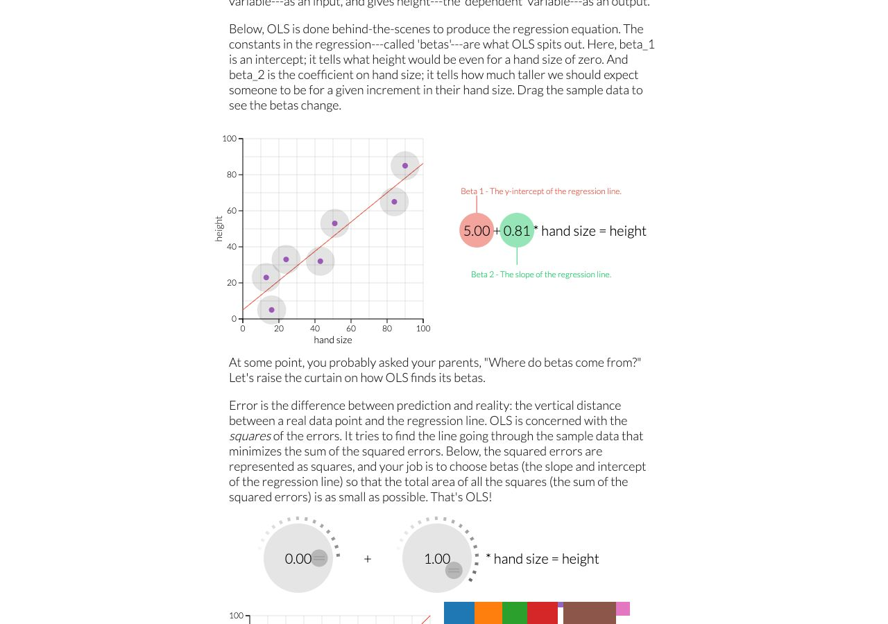</a>
  <figcaption>実ページの画面。 出典: <a href="https://setosa.io/ev/ordinary-least-squares-regression/">Ordinary Least Squares / EV</a></figcaption>
</figure>

最小二乗回帰の視覚的説明。点と直線、係数の関係を学ぶための短い単元。

形式: 操作 / 対象: 初級 / 言語: 英語 / 確認: JS・見出し

### [A Visual Exploration of Gaussian Processes](https://distill.pub/2019/visual-exploration-gaussian-processes/) {#algorithm-061}

<figure class="site-screenshot">
  <a href="../assets/ml-algorithm-screenshots/algorithm-061.jpg" target="_blank" rel="noopener">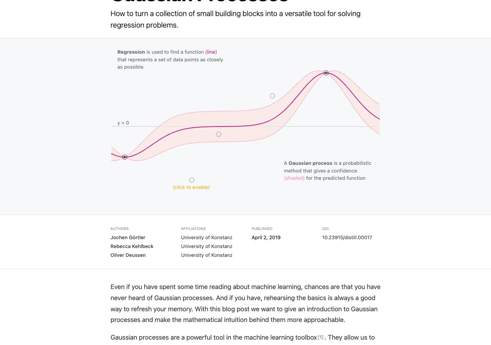</a>
  <figcaption>実ページの画面。 出典: <a href="https://distill.pub/2019/visual-exploration-gaussian-processes/">A Visual Exploration of Gaussian Processes</a></figcaption>
</figure>

カーネルと関数の事前分布・観測後の予測を視覚的に説明する。予測平均だけでなく不確実性を学ぶ。

形式: 操作型論文 / 対象: 中級〜上級 / 言語: 英語 / 確認: 本文

## 決定木・ランダムフォレスト・ブースティング {#category-trees}

### [A Visual Introduction to Machine Learning / Narrative Flow](https://narrative-flow.github.io/exploratory-study-2/) {#algorithm-102}

**試せる操作:** スクロールで散布図・ヒストグラム・分岐・決定木を順に表示する。データ点にカーソルを合わせ、予測時に通る経路を見る。

<figure class="site-screenshot">
  <a href="../assets/ml-algorithm-screenshots/algorithm-102.jpg" target="_blank" rel="noopener">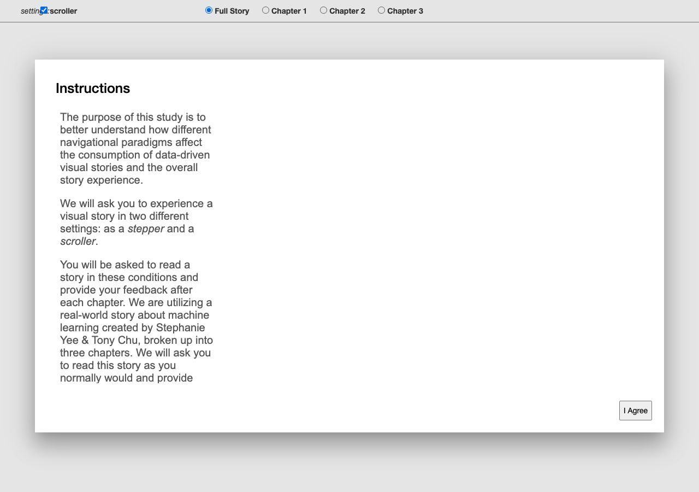</a>
  <figcaption>研究用の説明画面（初回表示）。 出典: <a href="https://narrative-flow.github.io/exploratory-study-2/">Narrative Flow公開版</a>（原作: R2D3）</figcaption>
</figure>

ニューヨークとサンフランシスコの住宅データを使い、「特徴量で分ける」から「分岐を繰り返して木を作る」までを図で追う。学習データとテストデータを木に流し、過学習まで一続きで説明する。決定木を最初に理解するための導入教材として掲載。

ページ末尾には、R2D3の原作を学術研究のために複製した版であると明記されている。MLUの決定木教材と併せて、分岐の直観から情報利得の説明へ進める。

初回アクセスでは研究用の説明画面が表示された。掲載画像はその初回画面で、教材部分の操作完了は未確認。

形式: スクロール連動・ホバー / 対象: 初級 / 言語: 英語 / 確認: ページ本文・初回画面

### [Decision Trees / MLU](https://mlu-explain.github.io/decision-tree/) {#algorithm-035}

**試せる操作:** 分割境界を動かし、エントロピーと情報利得の変化を比較する。

<figure class="site-screenshot">
  <a href="../assets/ml-algorithm-screenshots/algorithm-035.jpg" target="_blank" rel="noopener">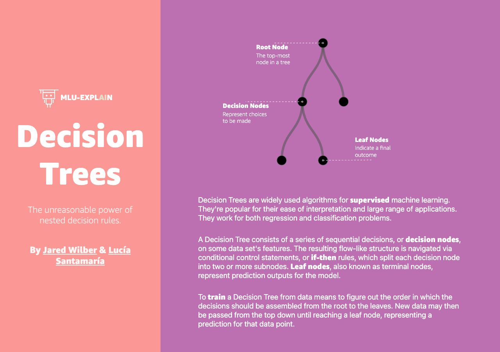</a>
  <figcaption>実ページの画面。 出典: <a href="https://mlu-explain.github.io/decision-tree/">Decision Trees / MLU</a></figcaption>
</figure>

分割境界を動かし、エントロピーと情報利得を比較する。木の深さと過学習まで一続きで学ぶ。

形式: 操作・スクロール / 対象: 初級〜中級 / 言語: 英語 / 確認: 本文

### [Random Forest / MLU](https://mlu-explain.github.io/random-forest/) {#algorithm-036}

<figure class="site-screenshot">
  <a href="../assets/ml-algorithm-screenshots/algorithm-036.jpg" target="_blank" rel="noopener">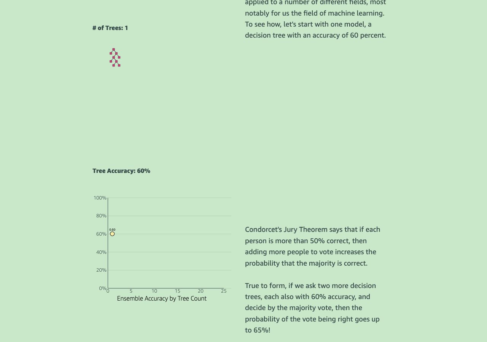</a>
  <figcaption>実ページの画面。 出典: <a href="https://mlu-explain.github.io/random-forest/">Random Forest / MLU</a></figcaption>
</figure>

決定木の集合と投票、標本・特徴量に入れるランダム性を図で説明。単一の木からアンサンブルへの接続に使う。

形式: 操作・解説 / 対象: 初級〜中級 / 言語: 英語 / 確認: 本文

### [Gradient Boosting / explained.ai](https://explained.ai/gradient-boosting/) {#algorithm-037}

<figure class="site-screenshot">
  <a href="../assets/ml-algorithm-screenshots/algorithm-037.jpg" target="_blank" rel="noopener">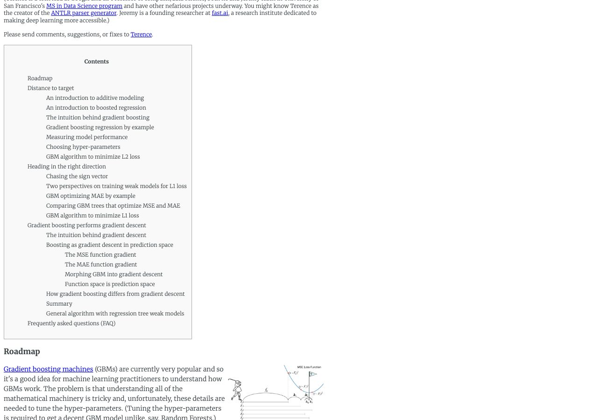</a>
  <figcaption>実ページの画面。 出典: <a href="https://explained.ai/gradient-boosting/">Gradient Boosting / explained.ai</a></figcaption>
</figure>

予測の残差を次のモデルで補う考え方を、図と数式で詳しく追う。操作型アプリよりも丁寧な視覚解説として利用。

形式: 図解・数式 / 対象: 中級 / 言語: 英語 / 確認: 本文

## 次元削減（PCA・t-SNE・UMAP） {#category-dimensionality-reduction}

### [Principal Component Analysis / EV](https://setosa.io/ev/principal-component-analysis/) {#algorithm-057}

**試せる操作:** 点をドラッグする。3Dの投影方向を変え、主成分の向きと射影を見る。

<figure class="site-screenshot">
  <a href="../assets/ml-algorithm-screenshots/algorithm-057.jpg" target="_blank" rel="noopener">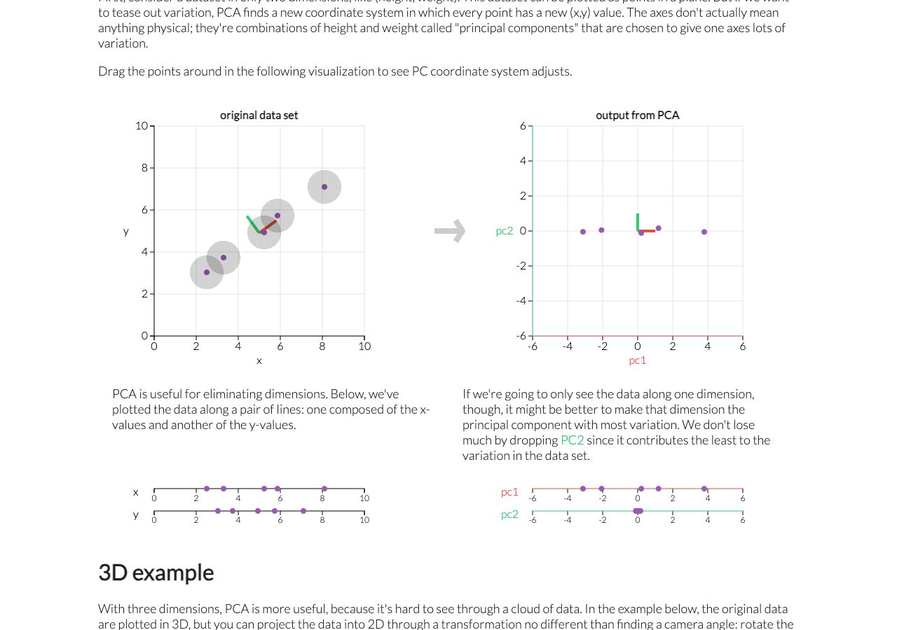</a>
  <figcaption>実ページの画面。 出典: <a href="https://setosa.io/ev/principal-component-analysis/">Principal Component Analysis / EV</a></figcaption>
</figure>

2Dの点を動かして主成分の変化を観察し、3Dの射影も比較する。分散を多く残す方向と次元削減をつなげる。

形式: 操作 / 対象: 初級〜中級 / 言語: 英語 / 確認: 本文

### [How to Use t-SNE Effectively](https://distill.pub/2016/misread-tsne/) {#algorithm-059}

**試せる操作:** 点群の例やperplexityを選び、反復の進行と埋め込みの形を比べる。

<figure class="site-screenshot">
  <a href="../assets/ml-algorithm-screenshots/algorithm-059.jpg" target="_blank" rel="noopener">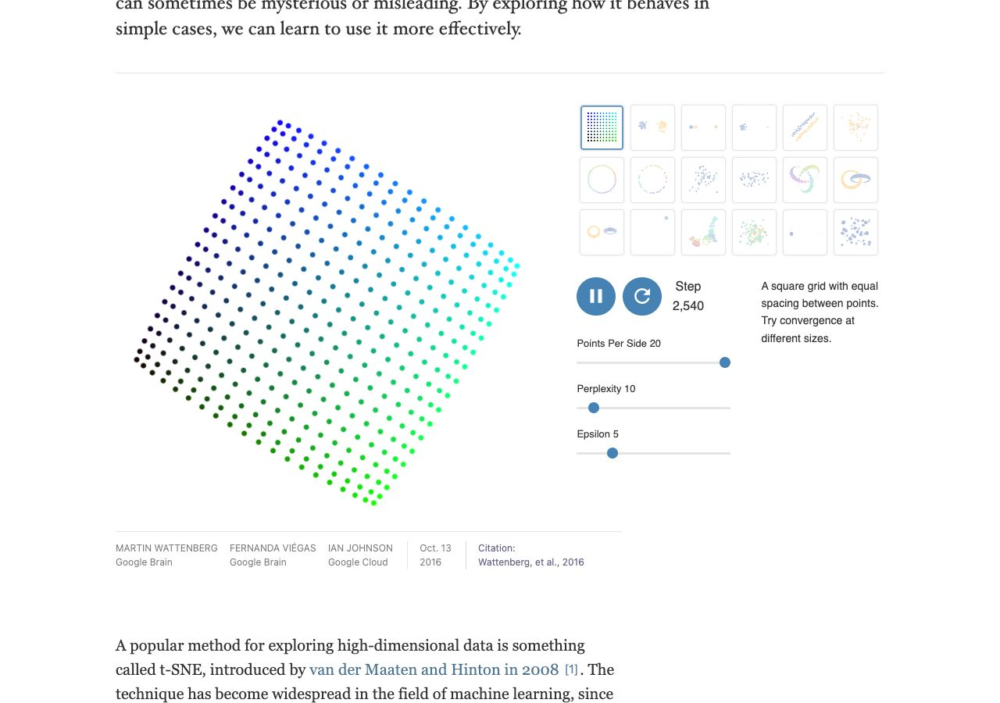</a>
  <figcaption>実ページの画面。 出典: <a href="https://distill.pub/2016/misread-tsne/">How to Use t-SNE Effectively</a></figcaption>
</figure>

perplexityや反復数で点群がどう変化するかを比較する。クラスタの大きさや距離を読み違えないための教材。

形式: 操作型論文 / 対象: 中級 / 言語: 英語 / 確認: 本文

### [How UMAP Works](https://umap-learn.readthedocs.io/en/latest/how_umap_works.html) {#algorithm-060}

<figure class="site-screenshot">
  <a href="../assets/ml-algorithm-screenshots/algorithm-060.jpg" target="_blank" rel="noopener">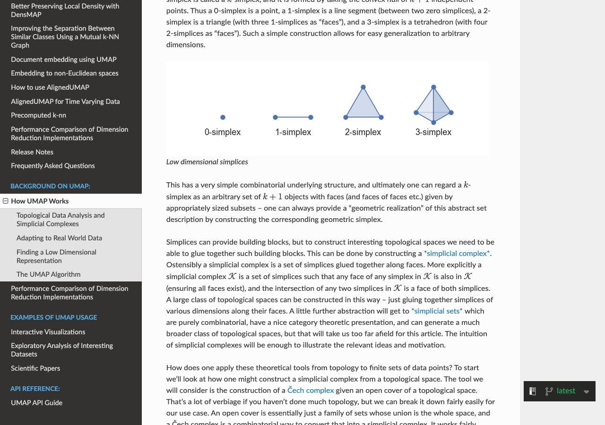</a>
  <figcaption>実ページの画面。 出典: <a href="https://umap-learn.readthedocs.io/en/latest/how_umap_works.html">How UMAP Works</a></figcaption>
</figure>

UMAP公式の視覚解説。近傍構造・グラフ・埋め込みを説明する。完成済みブラウザデモではなく図解と実装背景の資料。

形式: 図解・数式 / 対象: 中級〜上級 / 言語: 英語 / 確認: 本文

## CNN（畳み込みニューラルネットワーク）・画像処理 {#category-cnn}

### [CNN Explainer](https://poloclub.github.io/cnn-explainer/) {#algorithm-063}

**試せる操作:** 入力画像を選び、特徴マップや各層の演算の詳細を開く。

<figure class="site-screenshot">
  <a href="../assets/ml-algorithm-screenshots/algorithm-063.jpg" target="_blank" rel="noopener">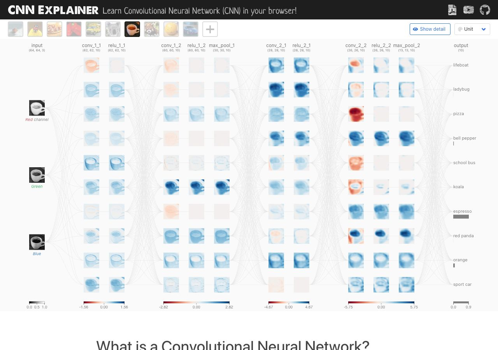</a>
  <figcaption>実ページの画面。 出典: <a href="https://poloclub.github.io/cnn-explainer/">CNN Explainer</a></figcaption>
</figure>

画像の入力から畳み込み、ReLU、プーリング、分類までをたどる。学習済みCNNの推論と各層の演算を観察する教材。

形式: 推論可視化 / 対象: 初級〜中級 / 言語: 英語 / 確認: JS・公式リポジトリ

[公式コード・説明](https://github.com/poloclub/cnn-explainer)。

### [Image Kernels / EV](https://setosa.io/ev/image-kernels/) {#algorithm-062}

**試せる操作:** カーネルを選ぶ・数値を変える。画素にカーソルを合わせ、積和演算を見る。

<figure class="site-screenshot">
  <a href="../assets/ml-algorithm-screenshots/algorithm-062.jpg" target="_blank" rel="noopener">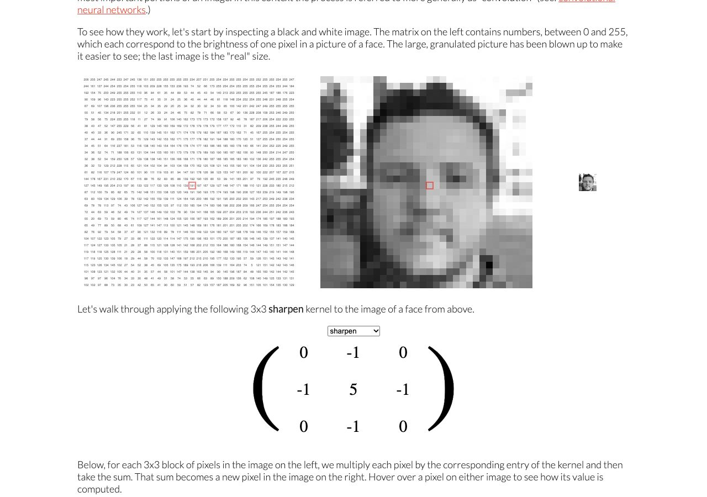</a>
  <figcaption>実ページの画面。 出典: <a href="https://setosa.io/ev/image-kernels/">Image Kernels / EV</a></figcaption>
</figure>

3×3の積和演算をピクセル単位で追える。ぼかし、輪郭、カスタムカーネルを比較し、CNNの前に画像フィルタを理解する。

形式: 操作 / 対象: 初級 / 言語: 英語 / 確認: 本文

### [TensorSpace](https://tensorspace.org/) {#algorithm-064}

<figure class="site-screenshot">
  <a href="../assets/ml-algorithm-screenshots/algorithm-064.jpg" target="_blank" rel="noopener">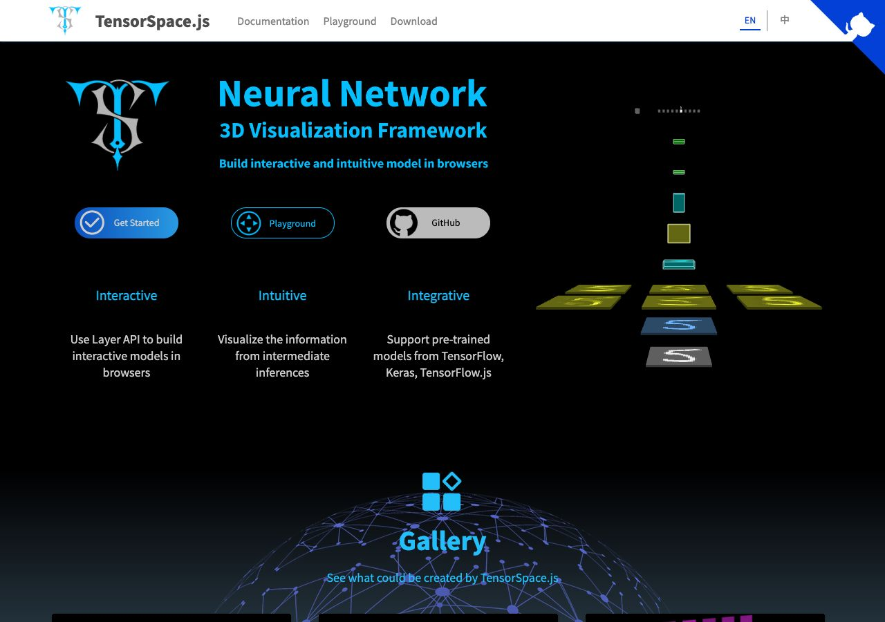</a>
  <figcaption>実ページの画面。 出典: <a href="https://tensorspace.org/">TensorSpace</a></figcaption>
</figure>

CNNなどの層と中間出力を3Dで探索する。LeNet、AlexNet、ResNetなどのギャラリーがあり、自作モデル用には変換・準備が必要。

形式: 3D探索・開発ツール / 対象: 中級 / 言語: 英語・中国語 / 確認: 本文

### [Computing Receptive Fields](https://distill.pub/2019/computing-receptive-fields/) {#algorithm-065}

<figure class="site-screenshot">
  <a href="../assets/ml-algorithm-screenshots/algorithm-065.jpg" target="_blank" rel="noopener">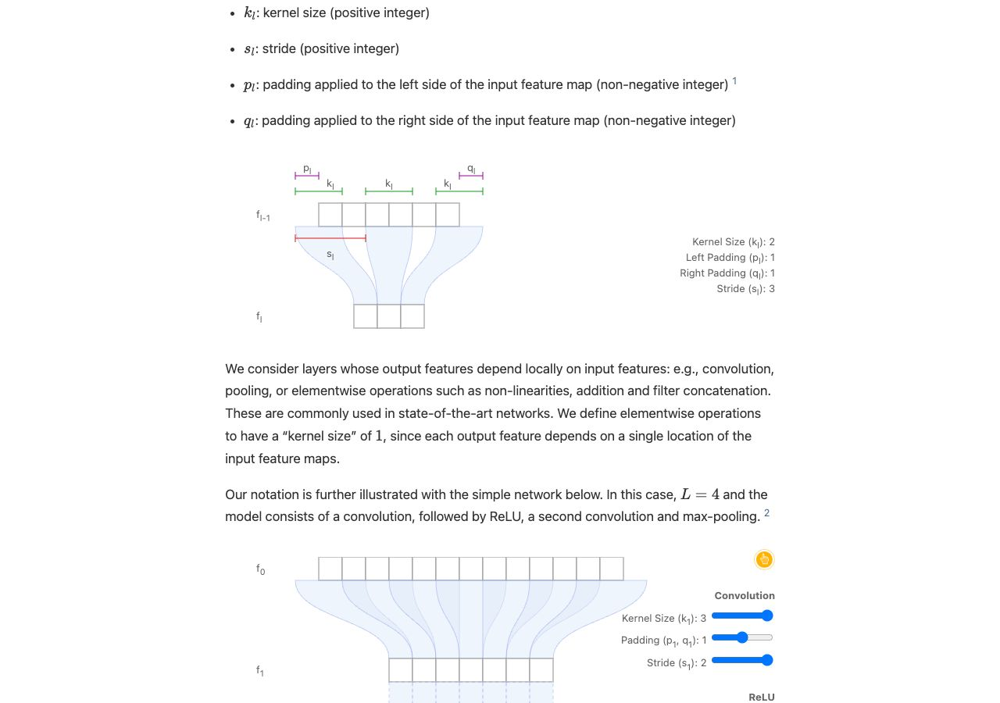</a>
  <figcaption>実ページの画面。 出典: <a href="https://distill.pub/2019/computing-receptive-fields/">Computing Receptive Fields</a></figcaption>
</figure>

CNNの受容野を図と式で追う。カーネル、stride、層の接続が入力上の範囲をどう変えるかを学ぶ。

形式: 図解・操作型論文 / 対象: 中級〜上級 / 言語: 英語 / 確認: 本文

### [Deconvolution and Checkerboard Artifacts](https://distill.pub/2016/deconv-checkerboard/) {#algorithm-066}

<figure class="site-screenshot">
  <a href="../assets/ml-algorithm-screenshots/algorithm-066.jpg" target="_blank" rel="noopener">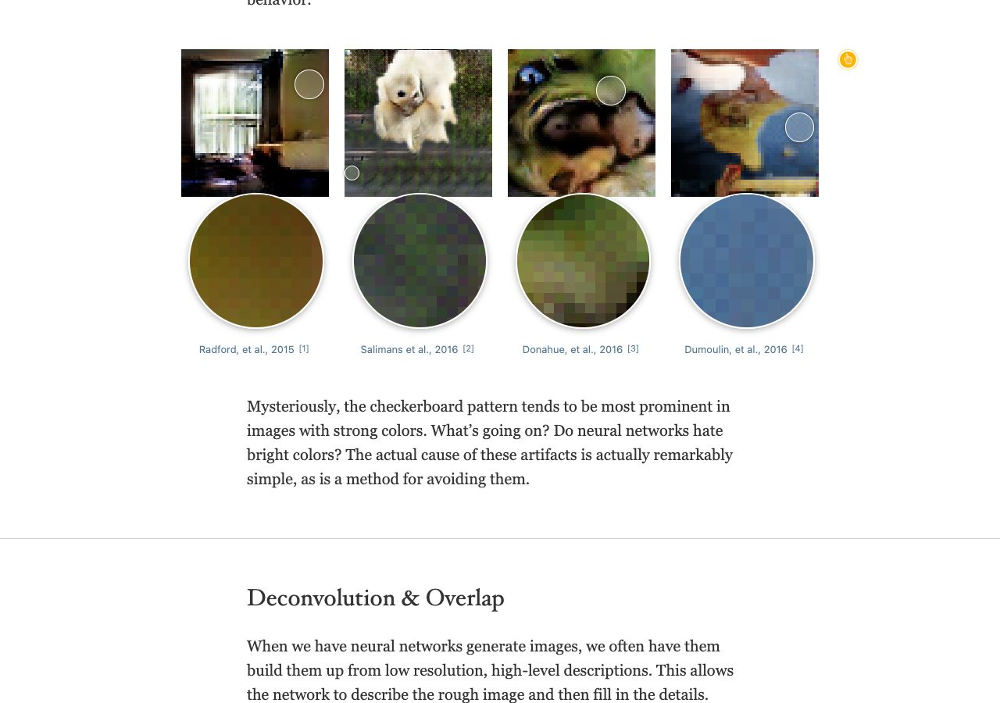</a>
  <figcaption>実ページの画面。 出典: <a href="https://distill.pub/2016/deconv-checkerboard/">Deconvolution and Checkerboard Artifacts</a></figcaption>
</figure>

転置畳み込みで格子状のアーティファクトが出る理由を視覚化する。画像生成やアップサンプリングの補助教材。

形式: 図解・操作型論文 / 対象: 中級 / 言語: 英語 / 確認: 本文

## RNN・LSTM {#category-rnn}

### [Understanding LSTM Networks](https://colah.github.io/posts/2015-08-Understanding-LSTMs/) {#algorithm-056}

<figure class="site-screenshot">
  <a href="../assets/ml-algorithm-screenshots/algorithm-056.jpg" target="_blank" rel="noopener">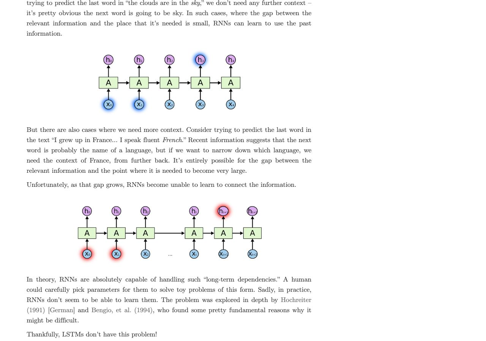</a>
  <figcaption>実ページの画面。 出典: <a href="https://colah.github.io/posts/2015-08-Understanding-LSTMs/">Understanding LSTM Networks</a></figcaption>
</figure>

RNNの時間展開とLSTMのゲートを図で解説する。操作型シミュレータではなく、系列モデルの構造を読む補助教材。

形式: 図解 / 対象: 中級 / 言語: 英語 / 確認: 本文

## Transformer・Attention・LLM {#category-transformer}

### [Transformer Explainer](https://poloclub.github.io/transformer-explainer/) {#algorithm-069}

**試せる操作:** 入力文や例文を変える。温度・サンプリング設定を調整し、Attentionと次トークン確率を見る。

<figure class="site-screenshot">
  <a href="../assets/ml-algorithm-screenshots/algorithm-069.jpg" target="_blank" rel="noopener">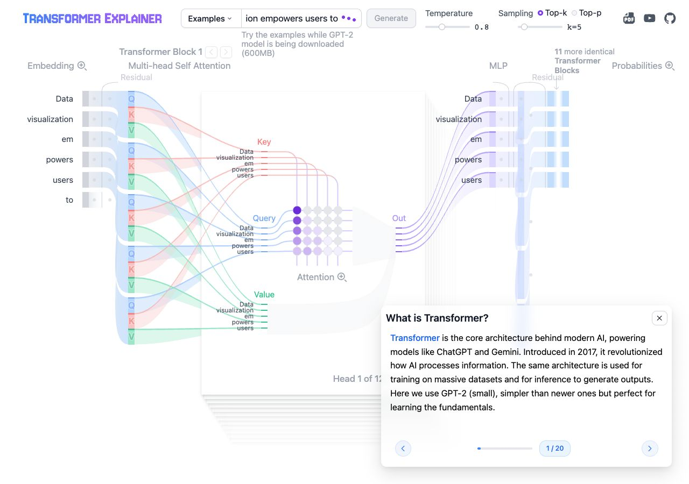</a>
  <figcaption>実ページの画面。 出典: <a href="https://poloclub.github.io/transformer-explainer/">Transformer Explainer</a></figcaption>
</figure>

GPT-2の入力から埋め込み、Attention、MLP、次トークン確率までを追う。温度やサンプリングを変えて生成を比較する。

形式: ブラウザ推論 / 対象: 初級〜中級 / 言語: 英語 / 確認: 本文・公式コード

[公式コード・説明](https://github.com/poloclub/transformer-explainer)。

### [LLM Visualization](https://bbycroft.net/llm) {#algorithm-070}

<figure class="site-screenshot">
  <a href="../assets/ml-algorithm-screenshots/algorithm-070.jpg" target="_blank" rel="noopener">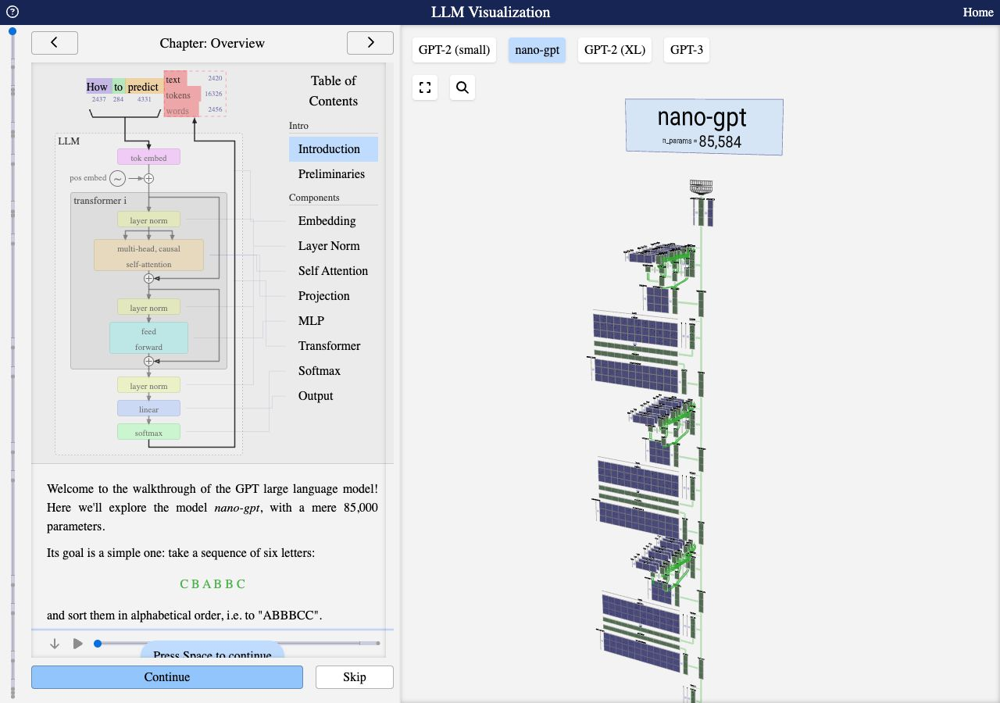</a>
  <figcaption>実ページの画面。 出典: <a href="https://bbycroft.net/llm">LLM Visualization</a></figcaption>
</figure>

Brendan BycroftによるGPT型モデルの3Dウォークスルー。行列・層・計算の配置を追い、モデルの規模感を理解する。

形式: 3D探索 / 対象: 中級 / 言語: 英語 / 確認: JS・公式コード

[公式コード・説明](https://github.com/bbycroft/llm-viz)。

### [The Illustrated Transformer](https://jalammar.github.io/illustrated-transformer/) {#algorithm-071}

<figure class="site-screenshot">
  <a href="../assets/ml-algorithm-screenshots/algorithm-071.jpg" target="_blank" rel="noopener">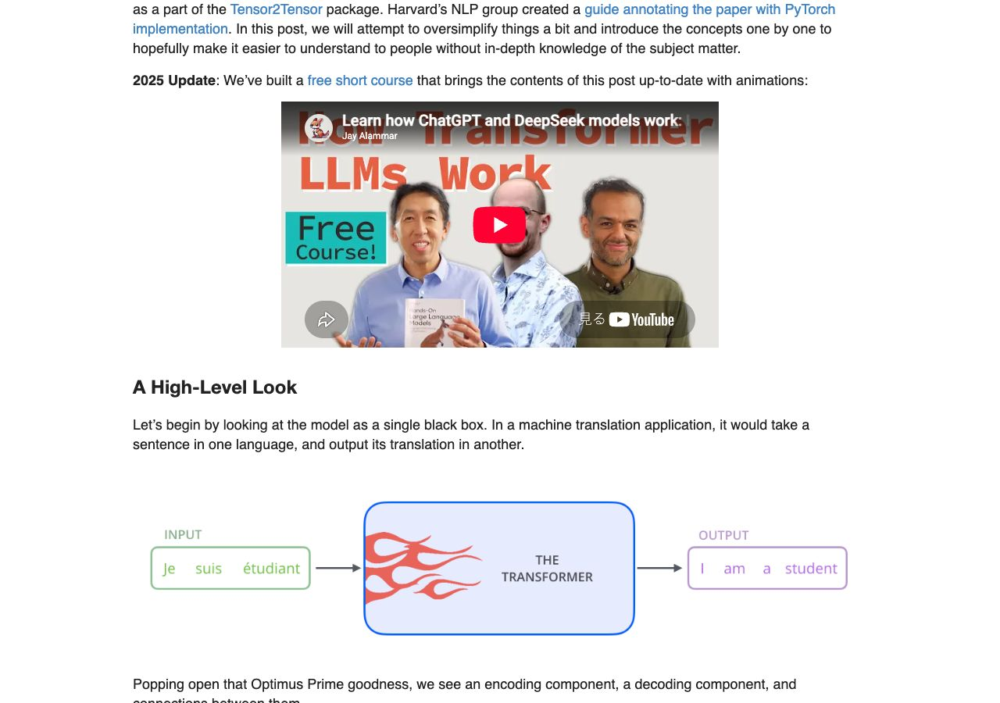</a>
  <figcaption>実ページの画面。 出典: <a href="https://jalammar.github.io/illustrated-transformer/">The Illustrated Transformer</a></figcaption>
</figure>

Jay AlammarによるTransformerの図解。Q・K・Vや多頭Attentionを読むための定番。操作型デモの前提説明として使う。

形式: 図解 / 対象: 初級〜中級 / 言語: 英語 / 確認: 本文

### [BertViz](https://github.com/jessevig/bertviz) {#algorithm-072}

<figure class="site-screenshot">
  <a href="../assets/ml-algorithm-screenshots/algorithm-072.jpg" target="_blank" rel="noopener">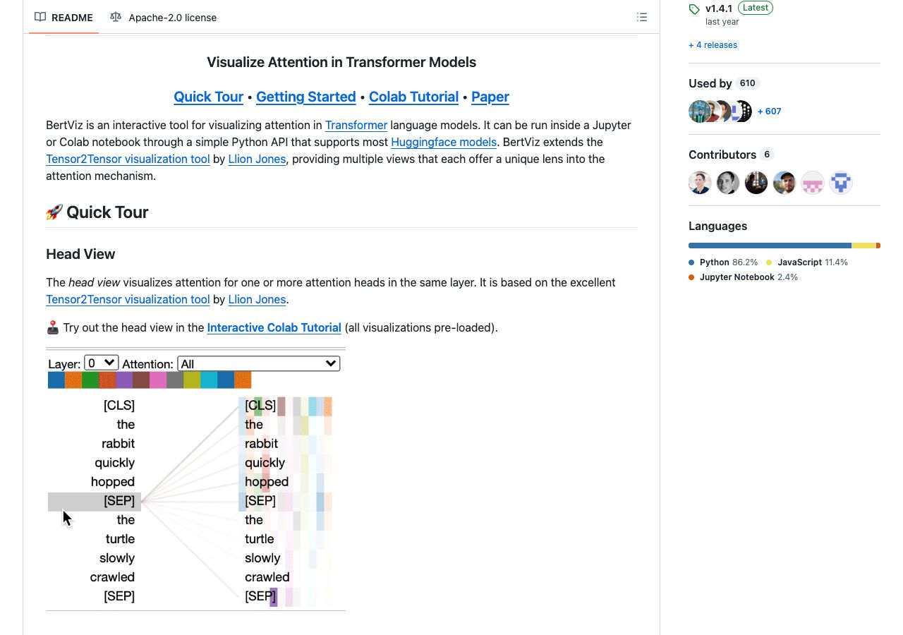</a>
  <figcaption>実ページの画面。 出典: <a href="https://github.com/jessevig/bertviz">BertViz</a></figcaption>
</figure>

Attentionをヘッド・モデル・ニューロンなどの視点で可視化する。自分の入力・モデルに使う場合はNotebook等の準備が必要。

形式: 分析ツール・Notebook / 対象: 中級〜上級 / 言語: 英語 / 確認: 本文

### [AttentionViz](https://attentionviz.com/) {#algorithm-074}

<figure class="site-screenshot">
  <a href="../assets/ml-algorithm-screenshots/algorithm-074.jpg" target="_blank" rel="noopener">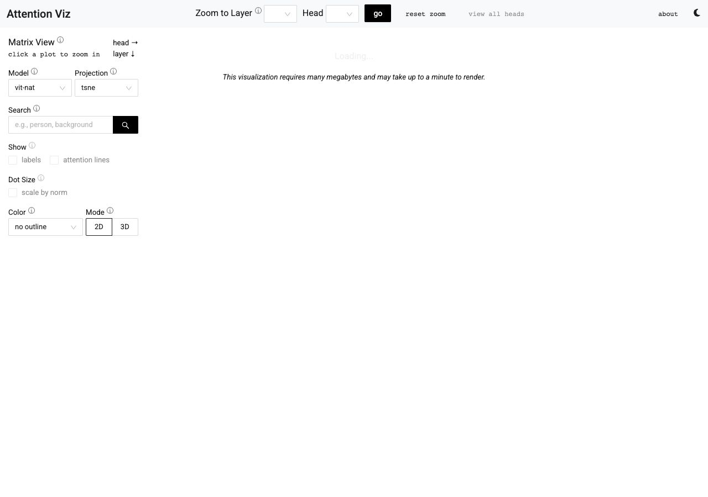</a>
  <figcaption>起動画面。データの読み込み完了は未確認 出典: <a href="https://attentionviz.com/">AttentionViz</a></figcaption>
</figure>

言語・画像TransformerのQueryとKeyを可視化し、複数のAttentionパターンを俯瞰する。研究者向けの分析にも使う。

形式: モデル探索 / 対象: 中級〜上級 / 言語: 英語 / 確認: JS・公式資料

[著者のリポジトリ](https://github.com/catherinesyeh/attention-viz)。

### [Vision Transformer Attention Visualization](https://huggingface.co/spaces/webml-community/attention-visualization) {#algorithm-068}

<figure class="site-screenshot">
  <a href="../assets/ml-algorithm-screenshots/algorithm-068.jpg" target="_blank" rel="noopener">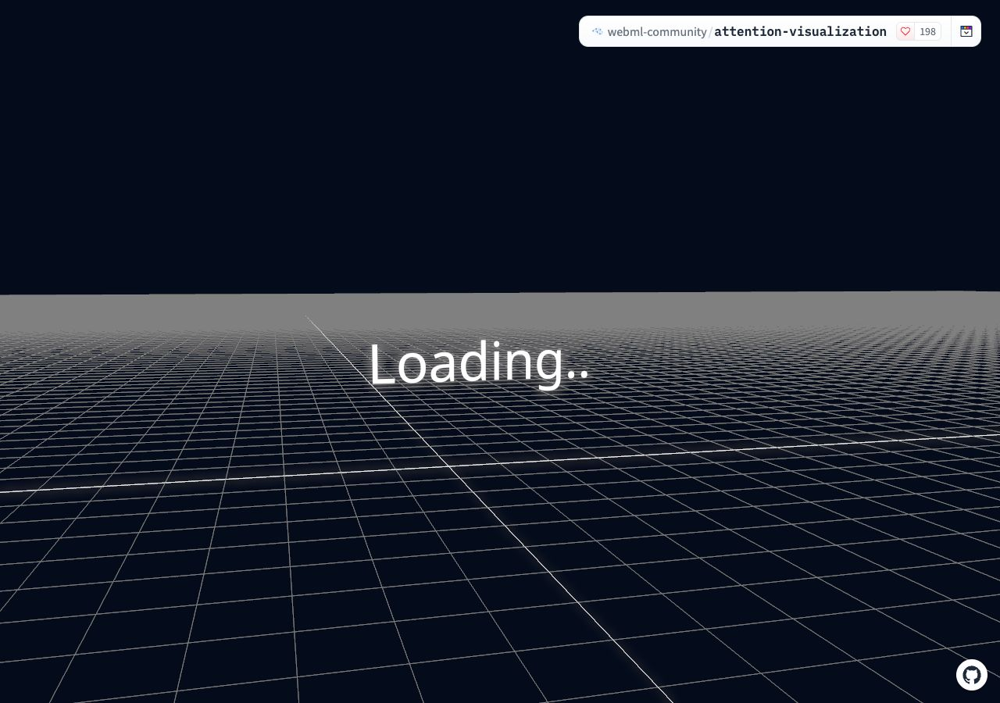</a>
  <figcaption>起動画面。モデルの読み込み完了は未確認。 出典: <a href="https://huggingface.co/spaces/webml-community/attention-visualization">Vision Transformer Attention Visualization</a></figcaption>
</figure>

画像上のAttentionを観察するHugging Faceのデモ。公式コードの入口も確認済み。Spaceの画面だけでは推論完了は確認していない。

形式: 推論可視化 / 対象: 中級 / 言語: 英語 / 確認: JS・公式コード

[公式サンプルコード](https://github.com/huggingface/transformers.js-examples/tree/main/attention-visualization)。

## GNN（グラフニューラルネットワーク） {#category-gnn}

### [A Gentle Introduction to GNNs](https://distill.pub/2021/gnn-intro/) {#algorithm-067}

<figure class="site-screenshot">
  <a href="../assets/ml-algorithm-screenshots/algorithm-067.jpg" target="_blank" rel="noopener">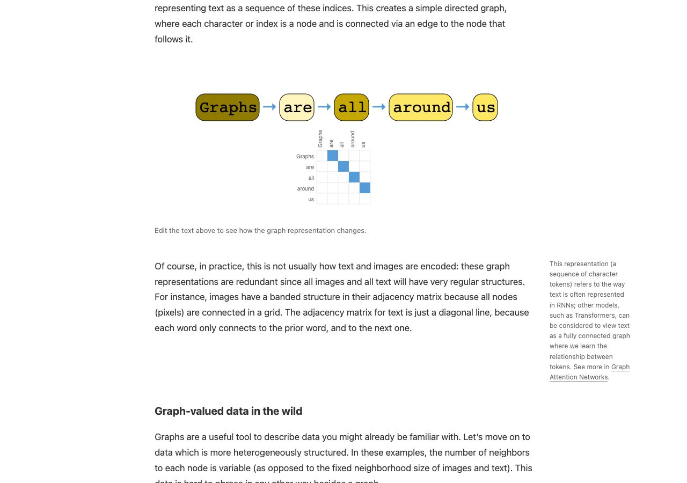</a>
  <figcaption>実ページの画面。 出典: <a href="https://distill.pub/2021/gnn-intro/">A Gentle Introduction to GNNs</a></figcaption>
</figure>

ノード・エッジ・グラフの表現とメッセージパッシングを視覚的に導入する。CNNや系列モデル以外へ対象を広げる。

形式: 図解・操作型論文 / 対象: 中級 / 言語: 英語 / 確認: 本文

## 生成モデル（GAN・拡散モデル） {#category-generative-models}

### [GAN Lab](https://poloclub.github.io/ganlab/) {#algorithm-075}

**試せる操作:** 目標分布や学習設定を変える。学習を再生・停止・ステップ実行する。

<figure class="site-screenshot">
  <a href="../assets/ml-algorithm-screenshots/algorithm-075.jpg" target="_blank" rel="noopener">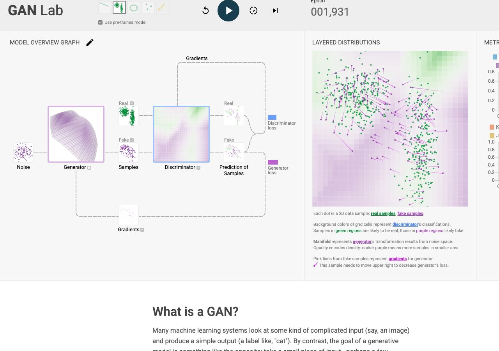</a>
  <figcaption>実ページの画面。 出典: <a href="https://poloclub.github.io/ganlab/">GAN Lab</a></figcaption>
</figure>

生成器と識別器の学習を2D分布で観察する。ハイパーパラメータ変更、低速再生、ステップ実行で対抗学習を追う。

形式: ブラウザ学習 / 対象: 初級〜中級 / 言語: 英語 / 確認: 本文

### [Diffusion Explainer](https://poloclub.github.io/diffusion-explainer/) {#algorithm-076}

**試せる操作:** 用意されたプロンプトと生成ステップを選び、ノイズ除去過程を見比べる。

<figure class="site-screenshot">
  <a href="../assets/ml-algorithm-screenshots/algorithm-076.jpg" target="_blank" rel="noopener">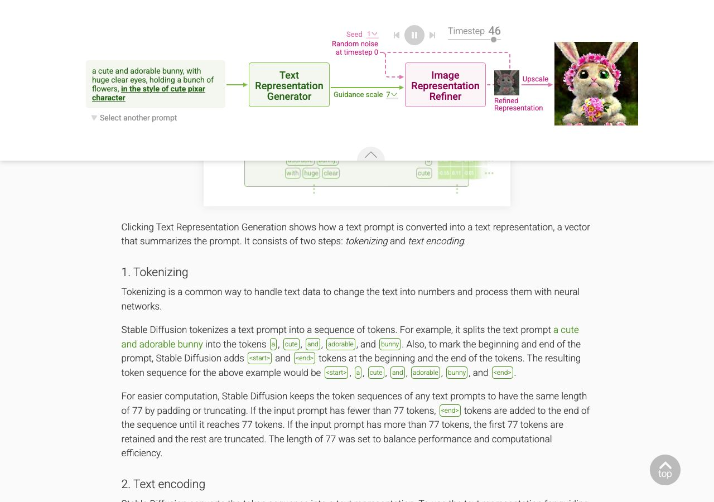</a>
  <figcaption>実ページの画面。 出典: <a href="https://poloclub.github.io/diffusion-explainer/">Diffusion Explainer</a></figcaption>
</figure>

用意されたプロンプトでStable Diffusionの構成とノイズ除去過程を観察する。任意のプロンプトを自由生成するサービスとは区別。

形式: 操作・生成過程 / 対象: 初級〜中級 / 言語: 英語 / 確認: JS・公式コード

[公式コード・説明](https://github.com/poloclub/diffusion-explainer)。

## 強化学習・バンディット {#category-reinforcement-learning}

### [REINFORCEjs](https://cs.stanford.edu/people/karpathy/reinforcejs/) {#algorithm-077}

**試せる操作:** GridWorldなどのデモを選び、価値・方策の更新を進める。

<figure class="site-screenshot">
  <a href="../assets/ml-algorithm-screenshots/algorithm-077.jpg" target="_blank" rel="noopener">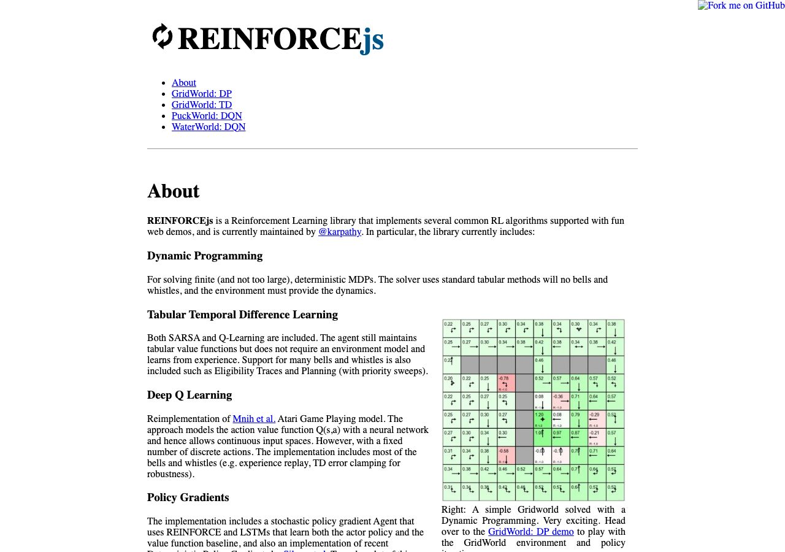</a>
  <figcaption>実ページの画面。 出典: <a href="https://cs.stanford.edu/people/karpathy/reinforcejs/">REINFORCEjs</a></figcaption>
</figure>

GridWorldの動的計画法・TD学習と、DQNのデモを収録。状態価値、方策、経験からの更新を学ぶ。古い教育用実装。

形式: ブラウザ学習 / 対象: 初級〜中級 / 言語: 英語 / 確認: 本文

### [Reinforcement Learning / MLU](https://mlu-explain.github.io/reinforcement-learning/) {#algorithm-078}

<figure class="site-screenshot">
  <a href="../assets/ml-algorithm-screenshots/algorithm-078.jpg" target="_blank" rel="noopener">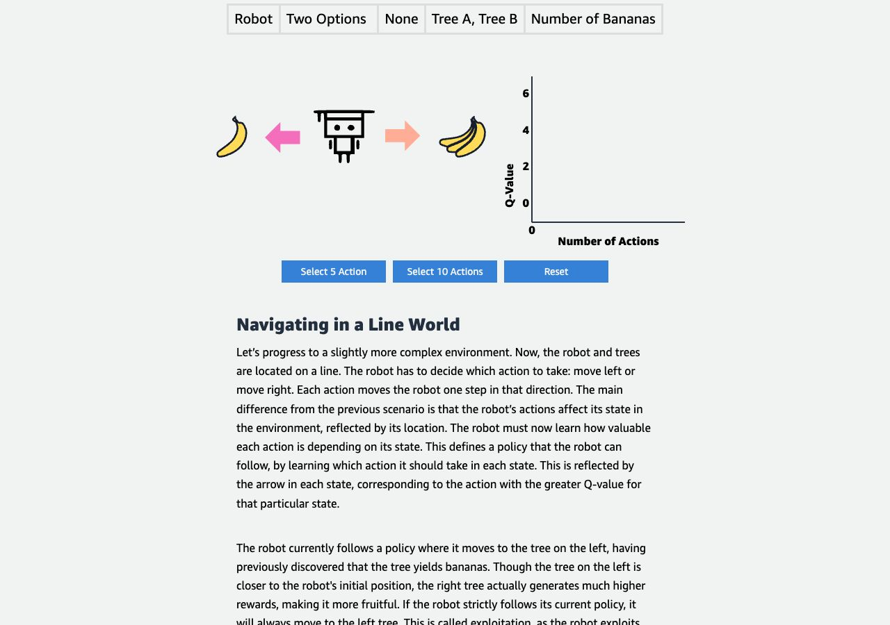</a>
  <figcaption>実ページの画面。 出典: <a href="https://mlu-explain.github.io/reinforcement-learning/">Reinforcement Learning / MLU</a></figcaption>
</figure>

強化学習と探索・活用のジレンマを導入する。REINFORCEjsの前に概念をつかむ短い教材。

形式: 操作・解説 / 対象: 初級 / 言語: 英語 / 確認: JS・公式目次

### [Thompson Sampling / Simon Ward-Jones](https://www.simonwardjones.co.uk/posts/thompson_sampling/) {#algorithm-079}

**試せる操作:** Play / Stopでバンディットのシミュレーションを進め、観測と推定を追う。

<figure class="site-screenshot">
  <a href="../assets/ml-algorithm-screenshots/algorithm-079.jpg" target="_blank" rel="noopener">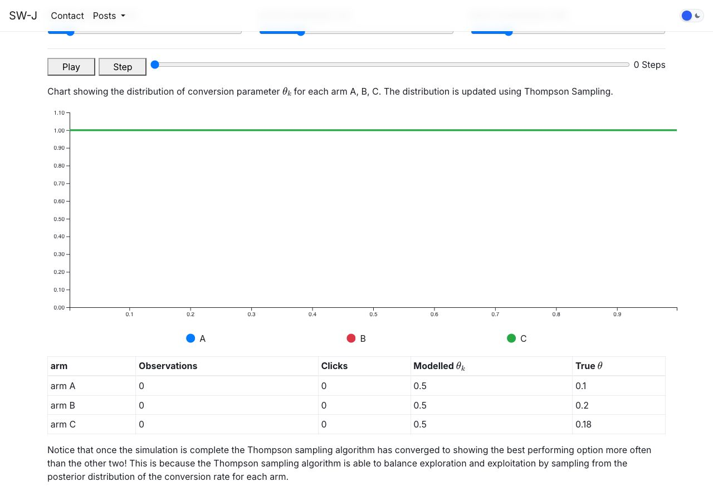</a>
  <figcaption>実ページの画面。 出典: <a href="https://www.simonwardjones.co.uk/posts/thompson_sampling/">Thompson Sampling / Simon Ward-Jones</a></figcaption>
</figure>

多腕バンディットとベイズ的な行動選択を説明する。推定の不確実性と探索をつなぐ。

形式: 図解・シミュレーション / 対象: 中級 / 言語: 英語 / 確認: 本文

### [Contextual Bandits / Simon Ward-Jones](https://www.simonwardjones.co.uk/posts/contextual_bandits/) {#algorithm-080}

**試せる操作:** Play / Stopで文脈付きバンディットのシミュレーションを進める。

<figure class="site-screenshot">
  <a href="../assets/ml-algorithm-screenshots/algorithm-080.jpg" target="_blank" rel="noopener">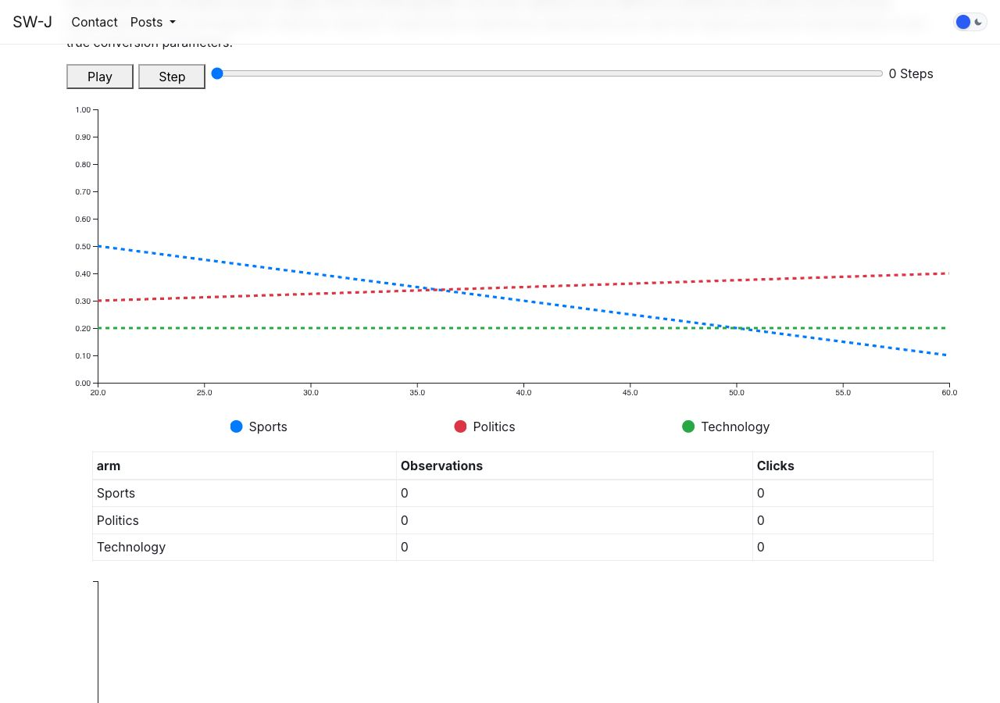</a>
  <figcaption>実ページの画面。 出典: <a href="https://www.simonwardjones.co.uk/posts/contextual_bandits/">Contextual Bandits / Simon Ward-Jones</a></figcaption>
</figure>

状況に応じて行動を選ぶ文脈付きバンディットを説明する。単純なバンディットから推薦・意思決定への接続に使う。

形式: 図解・解説 / 対象: 中級 / 言語: 英語 / 確認: 本文

## 複数の分類アルゴリズムを比較 {#category-model-comparison}

### [Decision Boundaries / ML Visualization](https://www.mlvisualization.com/visualizations/decision-boundaries) {#algorithm-101}

**試せる操作:** 点を追加・移動する。Blobs / Moons / Circles / Spiral / XORを切り替え、k・木の深さ・SVMのC・学習率を調整する。

同じ点群を使って、ロジスティック回帰・kNN・決定木・SVMの決定境界を横並びで比較する。データの形やモデルの設定を変えた結果を、その場で見比べられる。

<figure class="site-screenshot">
  <a href="../assets/ml-algorithm-screenshots/algorithm-101.jpg" target="_blank" rel="noopener">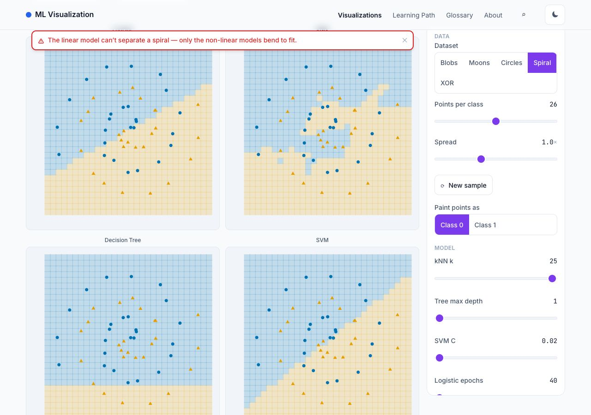</a>
  <figcaption>操作画面。出典: <a href="https://www.mlvisualization.com/visualizations/decision-boundaries">Decision Boundaries / ML Visualization</a></figcaption>
</figure>

形式: 操作型比較 / 対象: 初級〜中級 / 言語: 英語 / 確認: 公式本文・ブラウザ画面

## 複数カテゴリを扱う教材サイト {#category-collections}

### [ML Visualization](https://www.mlvisualization.com/) {#algorithm-007}

<figure class="site-screenshot">
  <a href="../assets/ml-algorithm-screenshots/algorithm-007.jpg" target="_blank" rel="noopener">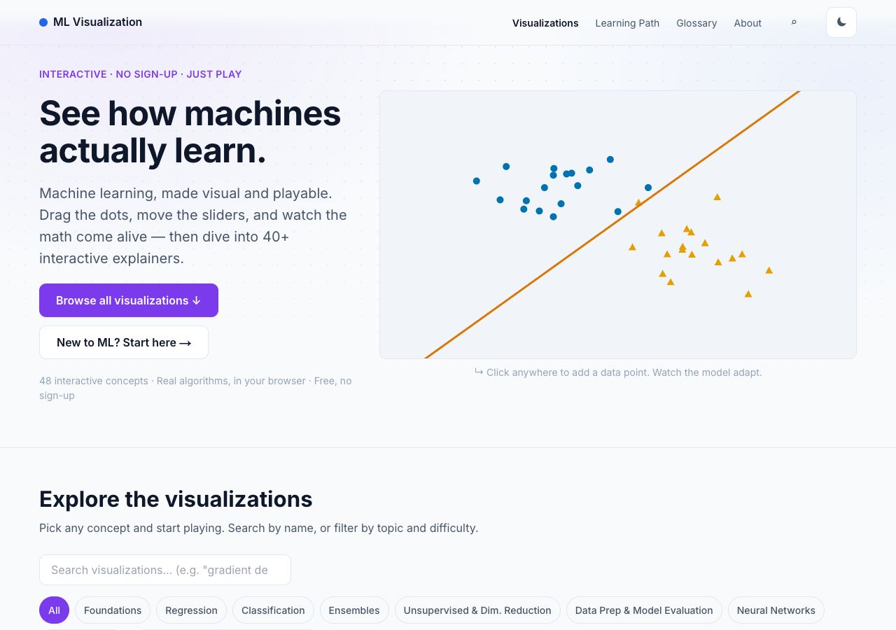</a>
  <figcaption>実ページの画面。 出典: <a href="https://www.mlvisualization.com/">ML Visualization</a></figcaption>
</figure>

回帰、分類、クラスタリング、前処理、ニューラルネットワークを横断する操作型百科。分野・難易度で教材を絞れる。

形式: 操作 / 対象: 初級〜上級 / 言語: 英語 / 確認: 本文

### [ML Hive Playground](https://www.mlhive.com/playground) {#algorithm-008}

<figure class="site-screenshot">
  <a href="../assets/ml-algorithm-screenshots/algorithm-008.jpg" target="_blank" rel="noopener">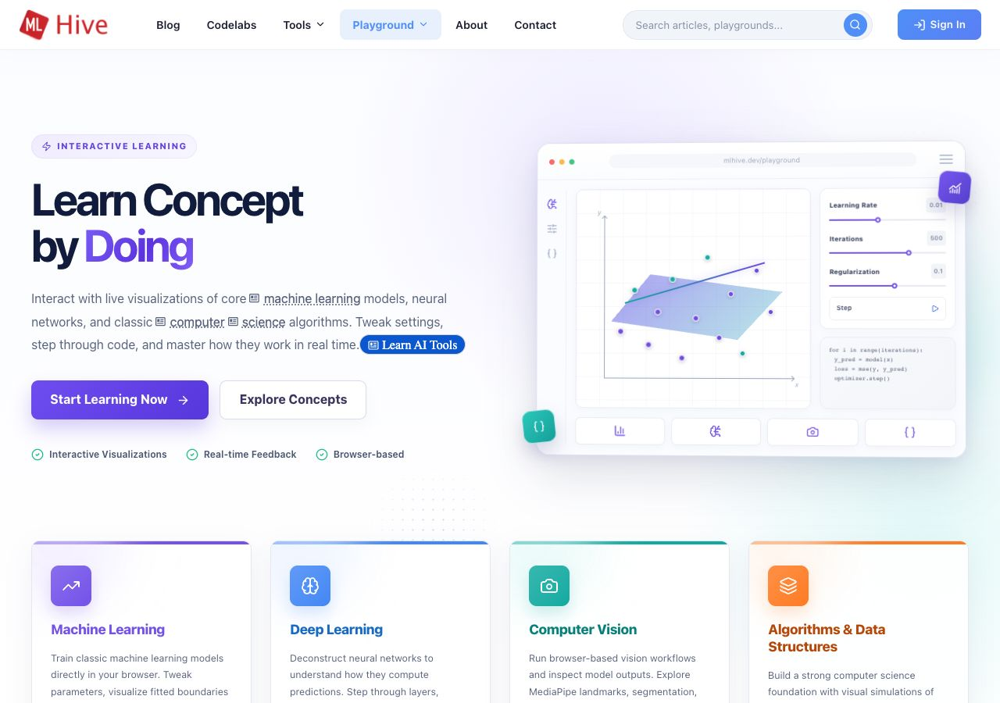</a>
  <figcaption>実ページの画面。 出典: <a href="https://www.mlhive.com/playground">ML Hive Playground</a></figcaption>
</figure>

機械学習・深層学習・画像処理・アルゴリズムの実験集。パラメータ変更とステップ実行、対応コードを結びつける構成。

形式: 操作・コード追跡 / 対象: 初級〜中級 / 言語: 英語 / 確認: 本文

### [ModelOrigen](https://modelorigen.in/) {#algorithm-009}

<figure class="site-screenshot">
  <a href="../assets/ml-algorithm-screenshots/algorithm-009.jpg" target="_blank" rel="noopener">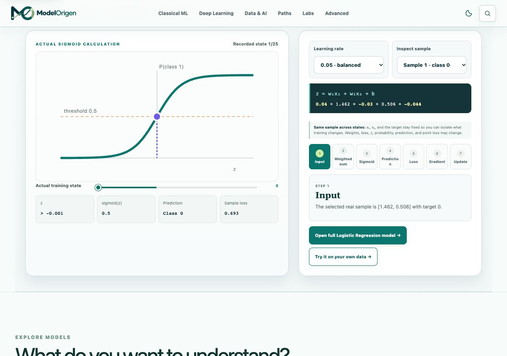</a>
  <figcaption>実ページの画面。 出典: <a href="https://modelorigen.in/">ModelOrigen</a></figcaption>
</figure>

回帰・分類からRNN、LSTM、GRU、Attention、評価まで幅広く案内する。教材ページとブラウザ計算型の可視化を組み合わせる。

形式: 操作・解説 / 対象: 初級〜上級 / 言語: 英語 / 確認: 本文

### [Interactive ML](https://www.interactive-ml.com/) {#algorithm-010}

<figure class="site-screenshot">
  <a href="../assets/ml-algorithm-screenshots/algorithm-010.jpg" target="_blank" rel="noopener">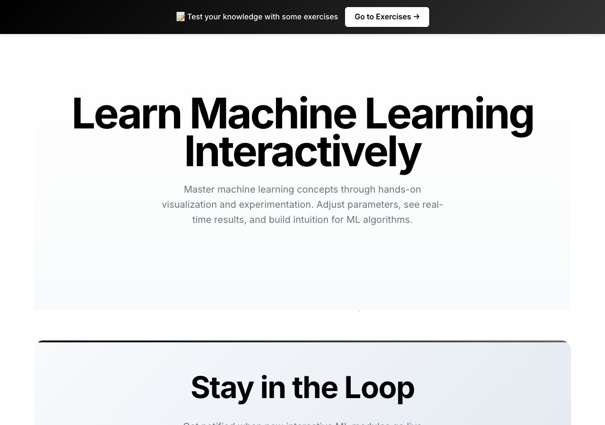</a>
  <figcaption>実ページの画面。 出典: <a href="https://www.interactive-ml.com/">Interactive ML</a></figcaption>
</figure>

回帰、SVM、Naive Bayes、クラスタリング、混同行列などを操作する教材群。Coming Soonの項目は利用可能教材として数えない。

形式: 操作 / 対象: 初級〜中級 / 言語: 英語 / 確認: 本文

## テーマ別に操作する順番

| テーマ | 順番 |
| --- | --- |
| 分類とモデル選択 | Decision Boundaries → TensorFlow Playground → SVMJS |
| 教師なし学習 | K-Means Clustering → PCA / EV → How to Use t-SNE Effectively |
| 画像の処理 | Image Kernels → CNN Explainer |
| 文章の生成 | Transformer Explainer → LLM Visualization |
| 生成モデルの学習 | GAN Lab → Diffusion Explainer |
| 強化学習 | Reinforcement Learning / MLU → REINFORCEjs |

[総合リンク集](ml-visualization-resources.html) / [総合リンク集のMarkdown](ml-visualization-resources.md)
